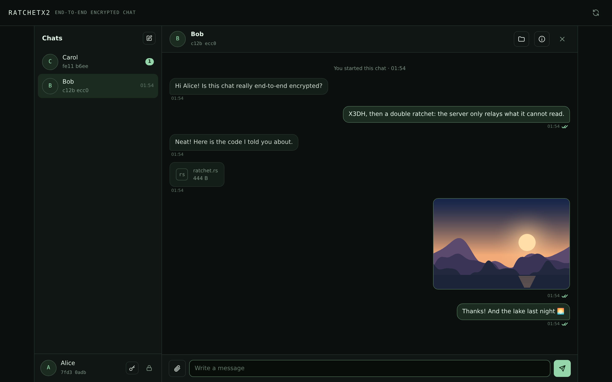

# About

- **[E2EE chat Worker](e2ee_chat_worker/README.md)**: the chat server as a Cloudflare Worker, over Connect, storing in Durable Objects and R2, and serving the web client
- **[E2EE chat web client](e2ee_chat_web/README.md)**: the web client, in Leptos: keys and sessions stay in the browser, in a vault sealed by a passphrase
- **[E2EE chat client](e2ee_chat_client/README.md)**: TUI chat client, support image; it talks to the Worker, and with the web client

Libraries; only `ratchetx2` is published on crates.io:

- **[ratchetx2](ratchetx2/README.md)**: Double-Ratchet
- **[xeddsa](xeddsa/README.md)**: XEdDSA, signing and Diffie-Hellman with one key
- **[x3dh](x3dh/README.md)**: X3DH key agreement, without I/O
- **[party](party/README.md)**: a chat party: double ratchet with header encryption, and the encrypted message format
- **[storage](storage/README.md)**: what the servers store, as traits over typed records, with an in-memory backend
- **[protocol](protocol/README.md)**: the handshake and mailbox protocol (protobuf), its client traits, the servers' logic, and Connect over any HTTP stack
- **[session](session/README.md)**: the client flow: publish keys, start or accept sessions, send and receive

All are pure Rust and build for `wasm32-unknown-unknown`, so a client can run in the browser and the servers' logic in e.g. a Cloudflare Worker, over a storage backend of its own, as the web client and the Worker do.
