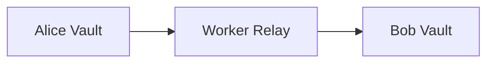

# E2EE Preview Smoke Document

This Markdown document exercises the Mermaid diagram worker (`preview_diagram`) and search (`preview_search`) for `MERMAID_NEEDLE_TOKEN`.



```rust
fn check() -> bool {
    true
}
```
